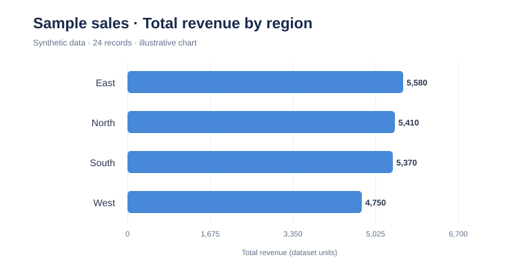
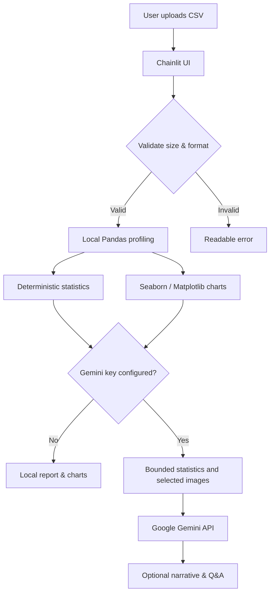

<div align="center">

# 📊 InsightFlow AI

**From raw CSV to interpretable insights — reproducible exploratory analytics with optional Gemini AI.**


*An independent portfolio project in data science, Python engineering, and responsible generative AI.*

</div>

## The problem

CSV files are everywhere, but turning them into useful evidence takes time: inspecting quality, understanding feature distributions, exploring correlations, and communicating the findings. InsightFlow AI combines **deterministic statistics** with **optional natural-language interpretations**, keeping the raw analysis auditable rather than relying on an LLM to invent numbers.

## Demo preview



*Example visualization produced from synthetic sales data included in `data/sample_sales.csv`. This is a chart preview, not a screenshot of the live Chainlit interface.*

## Features

| Capability | How it works | API key? |
| --- | --- | --- |
| CSV validation | UTF-8 parsing, file-size, row, and column limits | No |
| Dataset health report | Row/column counts, missing entries, duplicates, dtypes | No |
| Descriptive statistics | Count, mean, median, range and standard deviation | No |
| EDA visualizations | Correlation, histograms, categorical frequencies, and sampled pairplot | No |
| AI dataset summary | Interprets computed aggregates and flags uncertainty | Yes |
| AI chart notes | Gemini multimodal interpretation of up to two generated charts | Yes |
| Follow-up questions | Answers using supplied aggregates, not raw CSV rows | Yes |
| Automated checks | Unit tests and GitHub Actions for Python 3.11/3.12 | No |

## Architecture



## Technology stack

**Python · Pandas · NumPy · Seaborn · Matplotlib · Chainlit · Google GenAI SDK · pytest · Ruff · GitHub Actions**

The statistical outputs are computed in Python; AI is an optional interpretation layer, not a replacement for EDA.

## Quick start

**Requirements:** Python 3.11+, pip, Git, and optionally a Gemini API key.

```bash
git clone https://github.com/abhishek-singh-dsai/insightflow-ai.git
cd insightflow-ai
python -m venv .venv
```

Activate your virtual environment:

```bash
# macOS / Linux
source .venv/bin/activate

# Windows PowerShell
.venv\\Scripts\\Activate.ps1
```

Install and run:

```bash
python -m pip install -e .
chainlit run app.py -w
```

Open **http://localhost:8000**, then upload **`data/sample_sales.csv`**.

### Optional Gemini integration

1. Obtain an API key in [Google AI Studio](https://aistudio.google.com/apikey).
2. Duplicate `.env.example` to `.env` and set `GOOGLE_API_KEY` there.
3. Start the application again. `GEMINI_MODEL` can be overridden based on model availability and quota.

```dotenv
GOOGLE_API_KEY=your-key-here
GEMINI_MODEL=gemini-3.5-flash-lite
```

**Do not commit `.env`** or paste your actual API key into an issue. AI model availability, pricing, quotas and output quality depend on the Google account and model selected.

## Example analysis

Using the **synthetic** sample file, the app calculates numerical summaries and can generate correlation charts, histograms, a category bar chart, and a sampled pairplot. With Gemini configured, it can explain what those figures suggest, while preserving their exploratory limitations.

**Questions you can try:** “Which numerical feature has the highest mean?”, “What data-quality issues are present?”, “What analysis should I do next?” (Answers are constrained to the precomputed profile; the app does not execute natural-language queries against every row.)

## Project structure

```text
insightflow-ai/
├── app.py                      # Chainlit entry point
├── src/insightflow/
│   ├── analysis.py             # CSV validation & computed statistics
│   ├── visuals.py              # Bounded in-memory charts
│   └── ai.py                   # Optional Gemini summaries & Q&A
├── data/sample_sales.csv       # Synthetic demonstration data
├── assets/sample-chart.svg     # Generated sample preview (not UI screenshot)
├── tests/                      # Tests without external API calls
├── docs/                       # Architecture and reproducible sample report
├── .github/workflows/ci.yml    # CI for Python 3.11 and 3.12
├── .env.example                # API configuration template
├── chainlit.md                 # App landing page
├── pyproject.toml              # Package metadata & dev tooling
└── requirements.txt
```

For a reproducible example of the local output, see [Sample Analysis](docs/SAMPLE_ANALYSIS.md). For implementation tradeoffs, read [Architecture](docs/ARCHITECTURE.md).

## Development and testing

```bash
python -m pip install -e '.[dev]'
ruff check app.py src tests
pytest -q
```

Tests cover CSV parsing, dataset constraints, profiles, chart generation, missing/constant columns, and safe AI-disabled behavior. They **mock or avoid external API calls**; a passing test suite does not guarantee Gemini API availability or a deployed Chainlit UI.

## Data privacy and limitations

- **Raw CSV data is analyzed locally.** If AI is enabled, aggregated statistics and up to two generated chart images are sent to Gemini for interpretation. **Category names and chart labels may expose sensitive information**; avoid confidential or personal datasets.
- Files are limited to **10 MB**, **100,000 rows**, and **100 columns**. Visualizations sample up to **600 rows** and focus on a subset of features for performance.
- AI output can contain errors; verify conclusions against the computed statistics.
- Correlation is not causation. No significance test, forecasting, database, ML model, or live deployment is claimed.
- Numeric statistics are capped to 12 columns and category summaries to 8 columns to keep AI prompts bounded.
- No authentication, multi-tenant isolation, production hardening, or automatic deletion of framework-managed uploaded files is implemented.

## Roadmap

- [ ] Add a real Chainlit UI screenshot and short demonstration video
- [ ] Add downloadable HTML/PDF analysis reports
- [ ] Add user-selectable chart types and data transformations
- [ ] Expand test coverage with UI smoke tests and mocked Gemini SDK responses
- [ ] Add secure deployment, consent notice, and configurable retention

## Why I built this

I built InsightFlow AI to explore the intersection of **data analysis, explainable AI, and software engineering**. The central design decision is simple: calculate reliable evidence with Python first, then use an LLM only to help communicate that evidence. This project reflects my interest in practical data science workflows and responsible AI-assisted analytics.

## Author

**Abhishek Singh** · Data Science & Artificial Intelligence Enthusiast  
GitHub: [@abhishek-singh-dsai](https://github.com/abhishek-singh-dsai)

## License

MIT — see [LICENSE](LICENSE).
