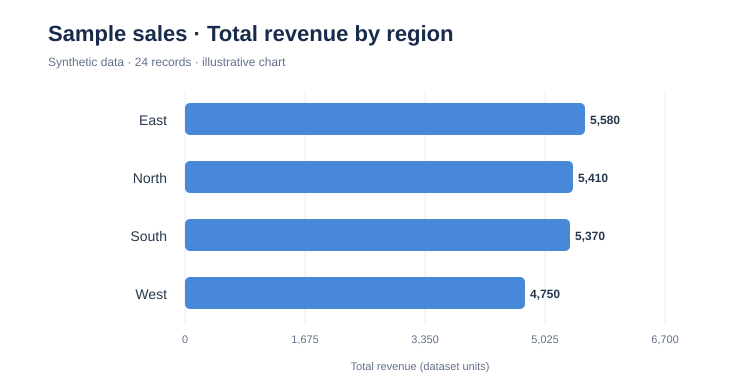

# Sample analysis — synthetic sales data

This report demonstrates the **local, deterministic** analysis generated for `data/sample_sales.csv`. All data is synthetic; no real company performance is represented.

## Dataset overview

- 24 rows and 7 columns
- Columns: `month`, `region`, `product`, `units`, `unit_price`, `revenue`, `ad_spend`
- Four regions and two product tiers
- No missing cells and no duplicate rows in this sample

## Report examples

The app calculates count, mean, median, min, max, and standard deviation for each selected numeric variable. It can plot distributions, a correlation heatmap, categorical frequencies, and sampled pairwise relationships.



**Interpretation:** the chart compares **total recorded revenue by region** in the synthetic dataset. It is descriptive only and does not establish causal effects or represent population-level performance.

## Reproduce

```bash
python -m pip install -e .
chainlit run app.py -w
```

Upload `data/sample_sales.csv` and review the generated profile and charts. A valid Gemini API key is optional for natural-language explanations; this report intentionally does not claim a verified live Gemini response.
